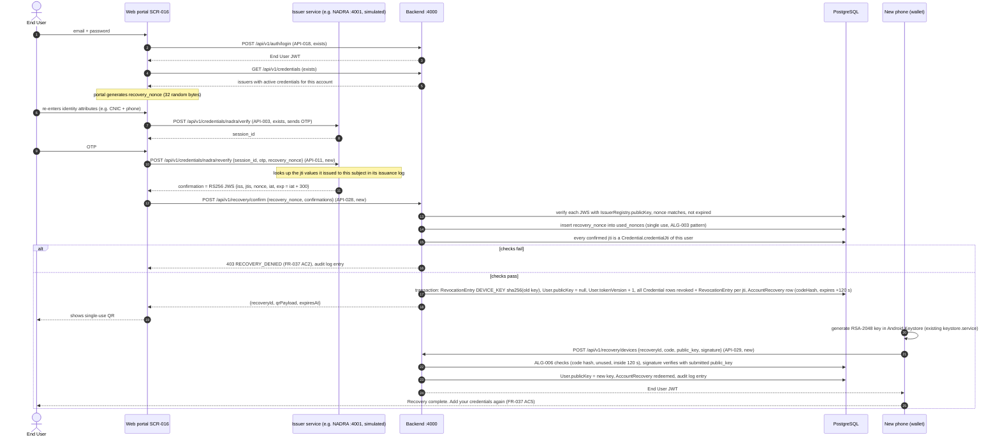
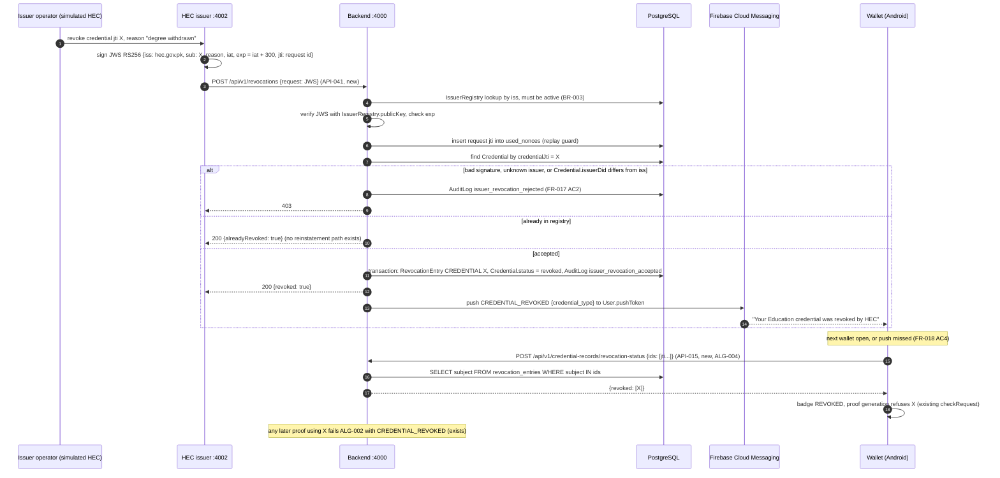
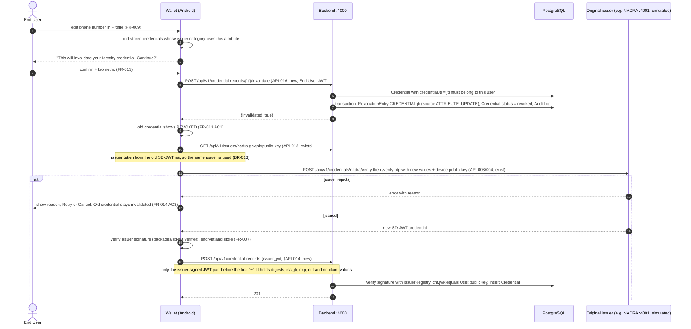
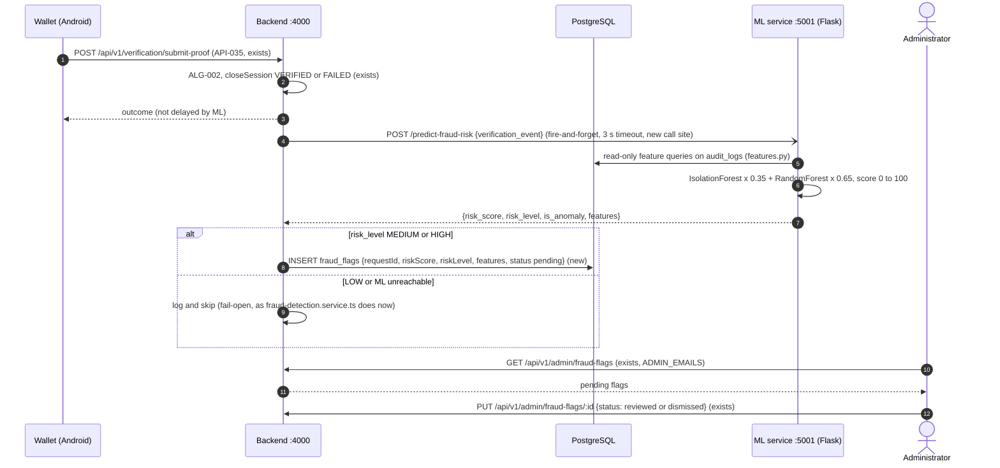

# NexusID: Designed, Not Yet Built

> Four features we have designed but not built yet. They are planned for the next sprint.
> Every "exists" claim below comes from reading the code at commit `0dc5dd4` (26 Nov 2026), and the file is named next to it.
> Every "to add" item does **not** exist in the repository today.
> Requirement IDs (FR / API / BR / ALG) are from `docs/REQUIREMENTS.md`.

The four issuers (NADRA :4001, HEC :4002, Air University :4003, LinkedIn :4004) are **simulated services**. They stand in for the real NADRA Verisys, HEC degree verification, the AU student portal and LinkedIn OAuth (SRS §1.5, "Real NADRA / HEC integration (simulated)"). So whenever a design below needs an issuer to "re-verify" or "revoke", we mean our simulated service. A real authority would have to expose the same contract.

---

## 0. Shared building block: one revocation registry

Features (a), (b) and (c) all need to add something to "the revocation registry". There is no such table today. What exists:

- `Credential.status` / `revokedAt` / `revocationReason` (`services/backend/prisma/schema.prisma`, model `Credential`). These are set by the End User route `POST /api/v1/credentials/:id/revoke` (`services/backend/src/routes/credentials.route.ts`, `services/backend/src/services/credentials.service.ts` `revokeCredential`).
- ALG-002 already refuses a proof whose credential row has `status = "revoked"`. It finds the row through the SD-JWT `jti` (`services/backend/src/services/verification.service.ts`, `runVerifyProof` step 4, using `Credential.credentialJti`).

That is not enough for the SRS:

- `Credential` rows cascade-delete with the `User`. A revocation could therefore disappear, which goes against BR-012.
- There is no way to revoke a **device key**, which BR-007 and NFR-013 require.

The design adds one append-only table that all three features write to:

```prisma
model RevocationEntry {
  id        String   @id @default(dbgenerated("gen_random_uuid()")) @db.Uuid
  kind      String   // CREDENTIAL | DEVICE_KEY
  subject   String   @unique            // credential jti, or SHA-256 of the device SPKI
  issuerId  String?  @map("issuer_id")  // set for kind = CREDENTIAL
  userId    String?  @map("user_id") @db.Uuid  // no FK on purpose: survives account deletion (BR-012)
  source    String   // ISSUER | ATTRIBUTE_UPDATE | ACCOUNT_RECOVERY
  reason    String?
  createdAt DateTime @default(now()) @map("created_at") @db.Timestamptz(6)
  @@index([userId])
  @@map("revocation_entries")
}
```

There is no update or delete path in code, so an entry can never be reinstated (FR-017 AC3). ALG-002 gets two checks before the cryptographic step:

1. Look up the credential `jti` in the registry and return `CREDENTIAL_REVOKED` if found.
2. Take the SHA-256 of the `cnf.jwk` holder key inside the SD-JWT and return `DEVICE_KEY_REVOKED` if that key is in the registry.

`Credential.status` stays as a display copy only.

---

## (a) Account recovery via issuer re-verification

### Purpose

FR-037 lets an End User who has lost their phone move the account to a new phone. The rules are:

- BR-024: they must prove the account is theirs with the registration email and password **and** a successful re-verification by an issuer.
- BR-007: the old device key goes into the revocation registry, so a stolen phone cannot keep producing valid proofs (FR-037 AC3).
- FR-037 AC4: a single-use QR code then links the new phone, which generates a fresh key pair.

The routes involved are API-018 (login, step 1), API-011 (`POST /reverify` on each issuer), API-028 (`POST /recovery/confirm`) and API-029 (`POST /recovery/devices`).

**Gap in the current build:** today a password alone is enough to replace the device key. The wallet signs in with `POST /api/v1/auth/login` and then calls `ensureDeviceKey`, which does `PUT /api/v1/users/me/public-key` (`apps/mobile/src/lib/device.ts`, `apps/mobile/src/services/api.service.ts` `updateMyPublicKey`). That PUT overwrites any existing key without issuer re-verification and without a registry entry (`services/backend/src/routes/users.route.ts`). The web stand-in key does the same (`apps/web/lib/webKeypair.ts`). Closing this gap is part of the feature.

### Sequence



The old credentials are bound to the old key through `cnf`, so they cannot be used from the new phone anyway. The user adds them again through the normal issuance flow, or through the re-issuance flow in (c).

### What already exists and is reused

| Piece                                                                                               | Where                                                                                                                     |
| --------------------------------------------------------------------------------------------------- | ------------------------------------------------------------------------------------------------------------------------- |
| Email + password check (bcrypt) and JWT issue                                                       | `services/backend/src/controllers/web-auth.controller.ts` (`webLogin`, `issueToken`)                                      |
| Listing which issuers hold active credentials for the account                                       | `GET /api/v1/credentials`, `services/backend/src/services/credentials.service.ts` `listCredentials`                       |
| Single-use, 120 s, hash-only QR challenge plus signature binding `nexusid-qr:<purpose>:<id>:<code>` | `services/backend/src/services/qr-challenge.service.ts` (`create`, `redeem`, `qrChallengeSigningInput`, `buildQrPayload`) |
| RSA signature check against a PEM key                                                               | `services/backend/src/lib/device-signature.ts` `verifyDeviceSignature`                                                    |
| Issuer public keys                                                                                  | `IssuerRegistry` model, `GET /api/v1/issuers/:id/public-key` (`services/backend/src/routes/issuers.route.ts`)             |
| Credential ID that matches what the issuer signed                                                   | `Credential.credentialJti`, filled by `recordCredential` in `credentials.service.ts`                                      |
| Single-use nonce table                                                                              | `UsedNonce` model, `consumeNonce` in `verification.service.ts`                                                            |
| NADRA OTP step (CNIC lookup, 5-minute in-memory session)                                            | `services/issuers/nadra/src/routes.ts` `POST /verify`                                                                     |
| Keystore key generation on the phone                                                                | `apps/mobile/src/services/keystore.service.ts`, `apps/mobile/src/lib/device.ts`                                           |
| QR scanner screen                                                                                   | `apps/mobile/src/screens/ScanScreen.tsx`                                                                                  |

### What has to be added

- **Issuers (all four):** `POST /api/v1/credentials/{nadra,hec,au,linkedin}/reverify` (API-011). Each returns a short-lived RS256 JWS signed with the key it already uses for issuance (`credential-builder.ts` / `employment-extractor.ts`).
  - NADRA reuses `/verify` for the OTP step.
  - LinkedIn takes the OAuth `code` and `state`.
- **Issuers:** a small **issuance log** that maps `sha256(subject identifier)` to the issued `jti` values. Nothing like it exists today: the issuers are stateless apart from in-memory sessions. Without it an issuer cannot say which NexusID credentials belong to the person in front of it.
- **Backend:** `routes/recovery.route.ts` and `services/recovery.service.ts` with API-028 (End User JWT) and API-029 (no JWT, authenticated by the QR code and proof of possession of the new key).
- **Prisma:**
  - `RevocationEntry` (section 0).
  - `AccountRecovery {id, userId, codeHash, status, expiresAt, redeemedAt, oldKeyFingerprint}`.
  - `User.tokenVersion Int @default(0)`, checked in `verifyJWT`. Today the lost phone keeps a valid 7-day JWT, because `auth.middleware.ts` has no revocation check.
- **Backend hardening:** `PUT /users/me/public-key` and `PUT /users/:id/public-key` only accept a key when `publicKey` is null. Any later change must go through API-029.
- **ALG-002:** add the `DEVICE_KEY_REVOKED` check from section 0.
- **Screens:**
  - Web SCR-016 `apps/web/app/auth/recover/page.tsx`: email/password, issuer step, QR.
  - Mobile: a "Recover account" entry on `SignInScreen.tsx`, and `ScanScreen.tsx` accepting `t=RECOVERY` in the QR payload.

### Likely viva questions

1. **Q: Why isn't the email and password enough?**
   A: Under BR-024 a leaked password must not be enough to take over the wallet. The issuer step proves the person is the same real-world identity that the credentials were issued to. _If pressed, open:_ `apps/mobile/src/lib/device.ts`. It shows that the current build has exactly this gap, and it is why we designed the feature.
2. **Q: How does the backend link an issuer confirmation to the account without storing the CNIC?**
   A: The issuer signs back the `jti` values it issued to that subject. The backend only checks that those IDs are in this user's `Credential.credentialJti` column, so it never sees an attribute value. _Open:_ `services/backend/prisma/schema.prisma` (model `Credential`).
3. **Q: What stops the stolen phone after recovery?**
   A: Its key fingerprint goes into the revocation registry, so ALG-002 flags its proofs as `DEVICE_KEY_REVOKED`. `tokenVersion` is also bumped, which kills its JWT. _Open:_ `services/backend/src/services/verification.service.ts` (`runVerifyProof`).

---

## (b) Issuer revocation

### Purpose

FR-017 lets an issuer revoke a credential it signed, for example a degree withdrawn by HEC. The request goes to API-041 `POST /api/v1/revocations` and is processed by ALG-008 AcceptIssuerRevocation:

- BR-019: the request is accepted only if it is signed by the issuer that signed the credential.
- FR-017 AC2: an invalid request is rejected and logged.
- FR-017 AC3: a revocation can never be undone.

FR-018 then requires three things:

- the End User is notified with the credential named (NFR-020: within 10 s for 95% of cases);
- the wallet shows the credential as Revoked;
- if the push is missed, the wallet catches up on next open by asking the backend through API-015 (ALG-004).

**Already done:** FR-017 AC4 (later proofs flagged) works once a credential row is marked revoked. `runVerifyProof` returns `CREDENTIAL_REVOKED` (`services/backend/src/services/verification.service.ts`, step 4).

**Bug found while writing this:** the wallet's catch-up check never sees a revocation.

- `refreshRevocation` calls `GET /credentials/{c.id}/revocation` with `c.id` = `SDJWTCredential.id` (`apps/mobile/src/store/credentials.store.ts`).
- The backend route looks up `Credential.id`, which is a different UUID (`credentials.service.ts` `checkRevocation`).
- `SDJWTCredential.id` and the SD-JWT `jti` are also two separate UUIDs (`packages/sd-jwt/src/issuer.ts`, `credentialId` vs `id: uuidv4()`).
- The result is a 404 every time, and the catch block swallows it.

API-015 below fixes this by keying on `jti`.

### Sequence



### What already exists and is reused

| Piece                                                                              | Where                                                                                                                                |
| ---------------------------------------------------------------------------------- | ------------------------------------------------------------------------------------------------------------------------------------ |
| ALG-002 revocation check by `jti`                                                  | `services/backend/src/services/verification.service.ts` `runVerifyProof`                                                             |
| `jti` read from an SD-JWT without verifying it                                     | `services/backend/src/lib/sd-jwt-payload.ts` `sdJwtCredentialId`, `decodeSdJwtPayload`                                               |
| Issuer registry with active flag and PEM key                                       | `IssuerRegistry` model                                                                                                               |
| Credential row with `credentialJti`, `issuerDid`, `revokedAt`, `revocationReason`  | `Credential` model, written by `credentials.service.ts` `recordCredential`                                                           |
| FCM sender with stale-token cleanup                                                | `services/backend/src/services/notification.service.ts` (has `sendVerificationRequest`; a `sendCredentialRevoked` sibling is needed) |
| Issuer signing keys and JWKS                                                       | each issuer's `credential-builder.ts` and `/.well-known/jwks.json`                                                                   |
| Wallet "revoked" state, badge and proof refusal                                    | `apps/mobile/src/lib/wallet.ts` `credentialStatus`, `apps/mobile/src/lib/proof.ts` `checkRequest`, `apps/mobile/src/lib/status.ts`   |
| Optional Fabric audit trail (fail-open; Fabric is not running in this environment) | `services/backend/src/services/blockchain.service.ts` `logRevocation`                                                                |

### What has to be added

- **Backend:** `routes/revocations.route.ts` (API-041, authenticated by the issuer signature only) and `services/revocation.service.ts` (ALG-008).
- **Backend:** `routes/credential-records.route.ts` with API-015 `POST /api/v1/credential-records/revocation-status` (End User JWT, body `{ids: string[]}` of `jti` values, returns the revoked subset, ALG-004).
- **Prisma:** `RevocationEntry` (section 0).
- **Notification:** `sendCredentialRevoked(pushToken, credentialType, issuerName)`. It must carry no claim values.
- **Issuers:** a revoke trigger, either a CLI script per issuer (`scripts/revoke.ts <jti> <reason>`) or an operator route on the issuer. It needs the issuance log from (a) so the issuer knows which `jti` to revoke.
- **Mobile:**
  - `credentials.store.ts` `refreshRevocation` switches to one API-015 call keyed by `jti` (this fixes the ID bug above).
  - The FCM handler accepts `type = CREDENTIAL_REVOKED`.
- **Policy decision:** End User self-revocation (`POST /api/v1/credentials/:id/revoke`) is not in the SRS and conflicts with BR-019 ("only the issuer may revoke"). We plan to rename it to "report as compromised" or drop it.

### Likely viva questions

1. **Q: How do you know the revocation really came from HEC and not an attacker?**
   A: The request is a JWS verified against HEC's key in our issuer registry. It is accepted only if the `iss` in it equals the `issuerDid` of the credential being revoked (BR-019). _Open:_ `services/backend/prisma/schema.prisma` (`IssuerRegistry`, `Credential`).
2. **Q: The phone was offline when the push was sent. Can it still use the revoked credential?**
   A: The wallet may still try, but the backend rejects the proof with `CREDENTIAL_REVOKED`, because ALG-002 checks the registry on every proof. The wallet also corrects its badge on next open through API-015. _Open:_ `services/backend/src/services/verification.service.ts`.
3. **Q: Does the backend learn anything about the degree when it revokes it?**
   A: No. It only stores the `jti`, the issuer and a reason string. The claims stay in the disclosures on the phone. _Open:_ `packages/sd-jwt/src/issuer.ts` (the payload holds only `_sd` digests, `iss`, `jti`, `exp`, `cnf` and the issuer label).

---

## (c) Credential invalidation and re-issuance

### Purpose

When an End User changes an attribute that a credential depends on (FR-009 AC2, e.g. a new phone number on the CNIC record), FR-013 requires two things:

- the old credential is shown as Revoked and its ID goes into the revocation registry (API-016 `POST /api/v1/credential-records/:id/invalidate`);
- BR-006: proofs from it are refused.

FR-014 then sends a re-issuance request to the same issuer that signed the old credential (BR-013). On success the new credential is stored and its metadata registered with API-014 `POST /api/v1/credential-records`. On failure the old credential stays invalidated and the user may retry. The wallet confirms status through API-015 / ALG-004, shared with (b).

**Current build:**

- There is no attribute-editing profile. `apps/mobile/src/screens/ProfileScreen.tsx` only shows device-key, biometric and privacy rows.
- There is no invalidation or re-issuance code in `apps/` or `services/`.
- Credential metadata is registered only as a side effect of the backend issuer proxies (`credentials.service.ts` `recordCredential`). That means attribute values pass **through** the backend in transit, which conflicts with FR-006 AC2. API-014 lets the wallet call issuers directly and register only metadata afterwards.

### Sequence



### What already exists and is reused

| Piece                                                                                                             | Where                                                                                                                                                                                  |
| ----------------------------------------------------------------------------------------------------------------- | -------------------------------------------------------------------------------------------------------------------------------------------------------------------------------------- |
| Issuer registry lookups                                                                                           | `GET /api/v1/issuers`, `GET /api/v1/issuers/:id/public-key` (`services/backend/src/routes/issuers.route.ts`); wallet `getIssuerPublicKey` in `apps/mobile/src/services/api.service.ts` |
| Issuance endpoints that re-issuance calls again                                                                   | `services/issuers/*/src/routes.ts` (API-003 to API-009)                                                                                                                                |
| Issuer-signed JWT with no claim values in its payload (only `_sd` digests plus `credential_type` / `issuer_name`) | `packages/sd-jwt/src/issuer.ts`, `services/issuers/*/src/credential-builder.ts` `alwaysVisibleClaims`                                                                                  |
| Reading `jti` / `iss` out of the SD-JWT                                                                           | `services/backend/src/lib/sd-jwt-payload.ts`                                                                                                                                           |
| Credential row shape, upsert by issuer credential ID                                                              | `credentials.service.ts` `recordCredential`, `Credential` model                                                                                                                        |
| Encrypted on-device store and local delete                                                                        | `apps/mobile/src/store/credentials.store.ts` (`addCredential`, `removeCredential`), `apps/mobile/src/lib/storage`                                                                      |
| Proof refusal for revoked credentials (wallet side and backend side)                                              | `apps/mobile/src/lib/proof.ts`, `verification.service.ts`                                                                                                                              |

### What has to be added

- **Backend:** `routes/credential-records.route.ts` with:
  - API-014 `POST /credential-records`: body `{issuer_jwt}`. It verifies the issuer signature and that `cnf` equals the account's device key, then stores `jti`, issuer, category and expiry.
  - API-016 `POST /credential-records/:jti/invalidate`.
  - API-015, shared with (b).
- **Backend:** once API-014 is live, retire the `recordCredential` side effect in the proxy routes, so the backend no longer has to sit in the issuance path.
- **Prisma:** `RevocationEntry` (section 0). `Credential` needs no change.
- **Mobile:**
  - An attribute profile. FR-008 says identity data is stored only encrypted on the device and never sent to the backend.
  - The attribute-to-category map from the predicate catalog (`PREDICATE_CATALOG` in `@nexusid/sd-jwt`).
  - An "invalidate and re-issue" confirmation sheet on `CredentialDetailScreen.tsx`, with retry and cancel states.
- **Web:** none needed. The End User portal does not edit attributes.

### Likely viva questions

1. **Q: Why invalidate before re-issuing instead of after?**
   A: Under BR-006 the old credential describes attributes that are no longer true. It must stop working the moment the user changes them, whether or not the issuer later accepts the new values. _Open:_ `docs/REQUIREMENTS.md` FR-014 AC3.
2. **Q: Doesn't API-014 leak the user's data to the backend?**
   A: No. We send only the issuer-signed JWT, whose payload holds salted digests and never the disclosures, so the backend learns the `jti`, issuer and expiry, which FR-007 AC4 already allows. _Open:_ `packages/sd-jwt/src/issuer.ts`.
3. **Q: How do you make sure re-issuance goes to the same issuer?**
   A: The wallet reads `iss` from the old credential and resolves that issuer in the registry, instead of letting the user pick one (BR-013). _Open:_ `services/backend/src/routes/issuers.route.ts`.

---

## (d) ML fraud-detection service

### Purpose

The fraud service gives an operator an advisory risk score for each completed verification, for example a burst of verifications from one account or a never-seen device. **REQUIREMENTS.md has no FR, API or ALG ID for fraud detection.** It is an extension outside the SRS catalogue, and we present it that way.

The constraints that apply to it:

- BR-015 / NFR-010: features must never contain claim values.
- BR-004: the score must never block or change a user's outcome. It only creates a `FraudFlag` for an administrator to review.

**What is built:** the Flask service and a trained model artifact exist.

**What is not built:**

- the backend client `services/backend/src/services/fraud-detection.service.ts` is imported nowhere;
- nothing writes `FraudFlag` rows;
- there is no admin screen.

The training data (`services/ml/data/synthetic_training.csv`) is synthetic, so any accuracy figure from `train.py` describes the generator, not real fraud.

### Sequence



### What already exists and is reused

| Piece                                                                                                                                         | Where                                                                                                               |
| --------------------------------------------------------------------------------------------------------------------------------------------- | ------------------------------------------------------------------------------------------------------------------- |
| Flask API: `POST /predict-fraud-risk`, `GET /health`, `GET /model/features`                                                                   | `services/ml/app.py`                                                                                                |
| 12-feature extractor (time of day, 1h/24h/7d counts, credential age and use count, first-time verifier, new device, field count, sensitivity) | `services/ml/features.py`                                                                                           |
| Two-stage model, thresholds LOW < 30, HIGH >= 70                                                                                              | `services/ml/model.py`                                                                                              |
| Training script, synthetic data, trained artifact                                                                                             | `services/ml/train.py`, `services/ml/data/synthetic_training.csv`, `services/ml/models/fraud_model.pkl`             |
| Container and compose wiring (`ML_SERVICE_URL` passed to backend)                                                                             | `services/ml/Dockerfile`, `infra/docker-compose.yml` service `ml`                                                   |
| Fail-open backend client                                                                                                                      | `services/backend/src/services/fraud-detection.service.ts` (not imported anywhere)                                  |
| `FraudFlag` model linked to `VerificationRequest`                                                                                             | `services/backend/prisma/schema.prisma`                                                                             |
| Admin review routes                                                                                                                           | `services/backend/src/routes/admin.route.ts` (`GET/PUT /admin/fraud-flags`), `requireAdmin` in `auth.middleware.ts` |

### What has to be added

- **Call site:** in `verification.service.ts` `submitProof`, after `closeSession` commits, call `fraudDetection.checkRisk(...)` without `await` and write a `FraudFlag` for MEDIUM or HIGH. It must sit outside the transaction so ML latency never delays the outcome (NFR-009).
- **Feature/data mismatches to fix first.** Right now the ML features silently fall back to defaults:
  - `features.py` filters `audit_logs.metadata->>'credential_id'` and `metadata->>'verifier_id'`. But `verification.service.ts` writes `proof_verified` metadata as `{user_id, condition, issuer, proofHash}`, with `verifierId` in a column. Either add `credential_jti` and `verifier_id` to that metadata or change the SQL to use the column.
  - `HIGH_SENSITIVITY_FIELDS = {"cnic", "date_of_birth"}` will never match, because sessions request predicate codes such as `AGE_OVER_18` (BR-021). Replace it with a predicate-code list or drop the feature.
  - `device_fingerprint` has no source. Use the SHA-256 of `User.publicKey`, so a key change after recovery (a) shows up as `new_device`.
- **Admin UI:** a small `apps/web/app/admin/fraud/page.tsx`. No admin pages exist today. Fix `GET /admin/audit-logs` too: `AuditLog.id` is a `BigInt` and no serializer exists, so `res.json` will throw once rows exist.
- **Evaluation:** a labelled test set from seeded demo traffic (`services/backend/src/db/seed-demo.ts`), and a stated false-positive rate. The synthetic-data result alone is not evidence.

### Likely viva questions

1. **Q: Can the model block a real user?**
   A: No. It runs after the outcome is stored and only creates a flag for a human to review, and if the ML service is down the check is skipped (fail-open). _Open:_ `services/backend/src/services/fraud-detection.service.ts`.
2. **Q: Doesn't fraud detection need personal data, which goes against your privacy claim?**
   A: The features are counts, times and booleans taken from the audit log, with no claim values, which keeps it within BR-015. The ML service has read-only database access. _Open:_ `services/ml/features.py`.
3. **Q: How accurate is it?**
   A: We can't claim a real accuracy yet, because the model was trained on synthetic data. Measuring it on seeded demo traffic is part of the next sprint. _Open:_ `services/ml/train.py`.
